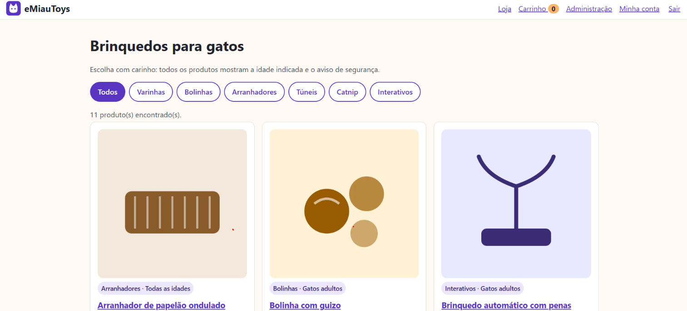
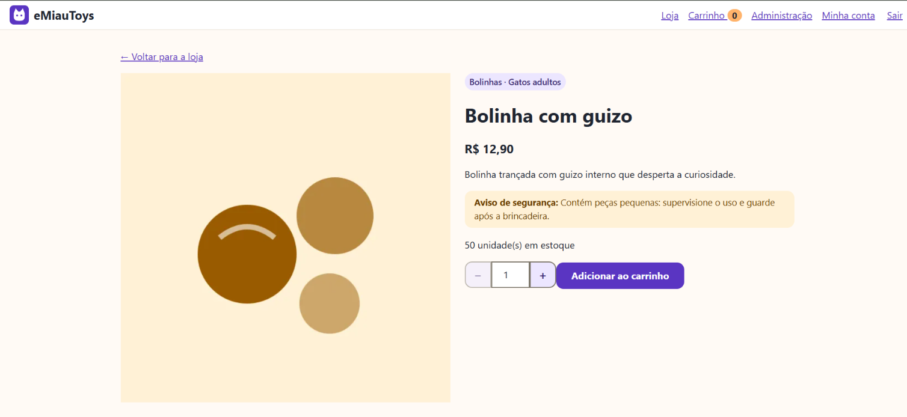
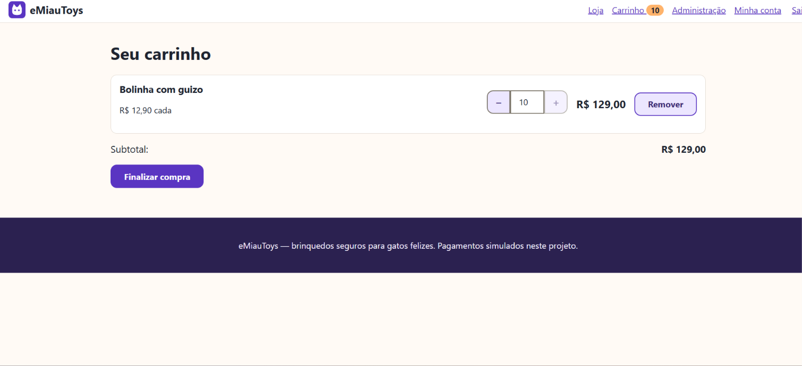
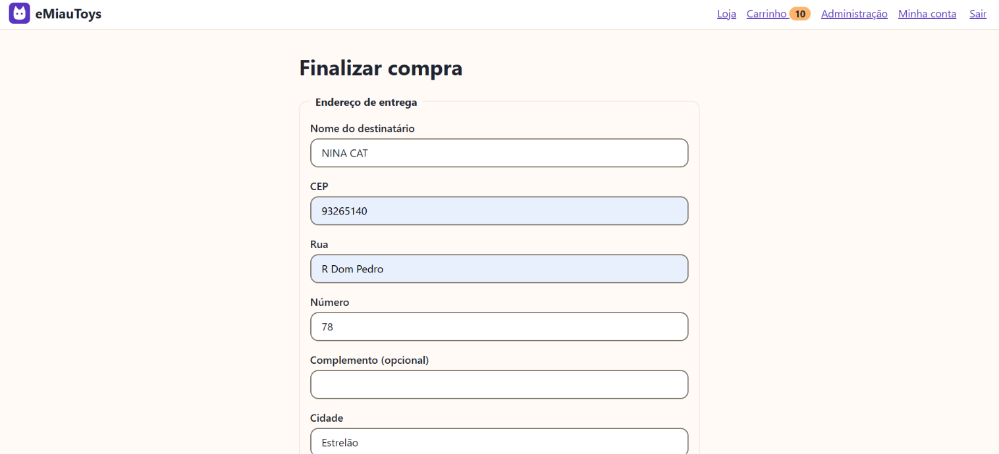
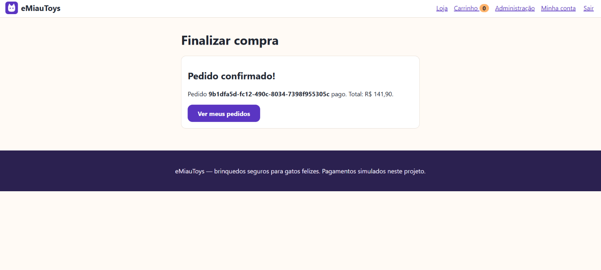
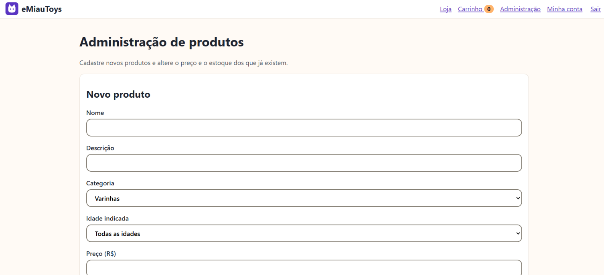
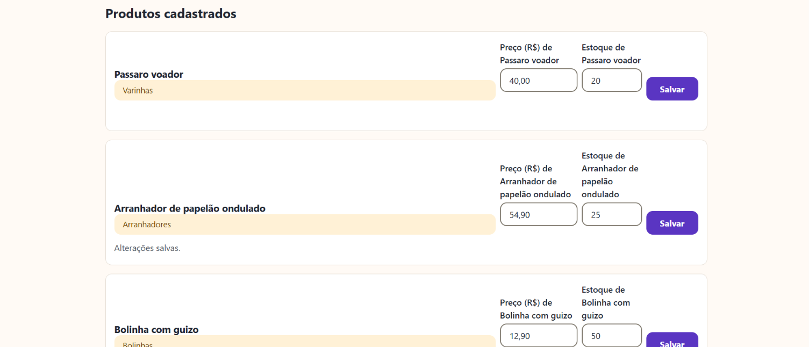

# eMiauToys 🐱

Loja online para pequenos comércios que vende brinquedos para gatos. Inclui login, catálogo com descrição, carrinho, frete, cupom e pagamento (simulado).

```
emiautoys/
├── backend/   Node.js (ES Modules) + SQLite — API REST
├── frontend/  Angular (standalone, Signals, rotas lazy) — CSS puro com design tokens
└── docs/      spec.md (com glossário) e ADRs
```

Ambos os projetos seguem a **Arquitetura Hexagonal** (`application` · `adapters` · `config`), descrita em `docs/adr/0001-arquitetura-hexagonal.md`.

## Telas

**Loja** — catálogo com filtro por categoria, idade indicada e aviso de segurança em todos os produtos.



**Produto** — detalhe com estoque e seletor de quantidade (− e +, de 1 até o menor valor entre 10 e o estoque).



**Carrinho** — quantidade com − e +, preço lido do produto a cada consulta e subtotal.



**Finalizar compra** — endereço de entrega, cotação de frete e cupom e escolha do meio de pagamento (simulado).



**Pedido confirmado** — depois do pagamento simulado, o pedido é gravado e o carrinho é esvaziado.



**Administração** (só para e-mails listados em `EMAILS_ADMINISTRADORES`, ADR 0007) — cadastro de produto novo e alteração de preço e estoque.





## Como rodar

**Back-end** (Node ≥ 22.13, sem dependências de execução):

```bash
cd backend
cp .env.example .env     # ajuste SEGREDO_TOKEN e EMAILS_ADMINISTRADORES (quem pode cadastrar/alterar produtos)
npm start                # http://127.0.0.1:3000  (catálogo e cupons de exemplo são criados na 1ª execução)
npm test                 # testes + cobertura mínima de 80%
```

**Front-end:**

```bash
cd frontend
npm install
npm start                # http://localhost:4200 (proxy de /api para a porta 3000)
npm run test:application # testes dos casos de uso (rodam sem Angular)
npm run test:arquitetura
npm run test:componentes  # testes de componente (Angular TestBed + Vitest)

# E2E de interface (Playwright): sobe API e Angular sozinho
npx playwright install chromium   # uma única vez
npm run test:e2e
```

Cupons de exemplo: `MIAU10` (10%) e `BEMVINDO` (5%). Para simular recusa no cartão, o token `tok_recusado` é recusado pela API.

## Estado da verificação

| Item | Estado |
|------|--------|
| Back-end: 144 testes (unidade, contrato, integração, E2E da API, arquitetura) | ✅ passando, cobertura de linhas 98,65% (`npm test`) |
| Front-end: casos de uso, validações e regra de dependência (32 testes: 25 de aplicação, com a administração de produtos, e 7 de arquitetura) | ✅ passando; `tsc --strict` limpo na camada `application` |
| Front-end: componentes Angular, rotas, HTTP, estilos | ✅ compilam e rodam no navegador (verificado pela execução dos testes abaixo) |
| Testes de componente: carrinho, checkout e seletor de quantidade (21 testes, `npm run test:componentes`) | ✅ passando |
| E2E de interface com Playwright (11 testes, `npm run test:e2e`) | ✅ passando, incluindo a jornada de compra, a exclusão de conta e a tela de 320 px |
| ESLint e dependency-cruiser (back-end e front-end) | ✅ sem erros (`npm run lint`, `npm run arquitetura`); o lint do back-end tem 5 avisos de números mágicos |
| Prettier (`npm run format:check`) | ⚠️ aponta arquivos fora do padrão de formatação; não foi aplicado |
| Contraste WCAG AA da paleta | ✅ verificado por cálculo (todos os pares ≥ 4,5:1) |
| Lighthouse (LCP ≤ 2,5 s, Performance ≥ 90) | ❌ não medido |

Documentação do carrinho (domínio, casos de uso, API, front-end, regras e limitações): `docs/carrinho.md`.

Detalhes e como migrar cada substituição: `docs/adr/0002-substituicoes-por-falta-de-rede.md`.

## Mapa dos artigos da especificação

| Artigo | Onde está |
|--------|-----------|
| III Test-first | `backend/testes`, `frontend/testes`; cobertura mínima imposta em `npm test` |
| IV Stack | Angular `strict`, CSS puro (`frontend/src/styles.css`), Node ES Modules, SQLite com repositórios trocáveis |
| V Acessibilidade | rótulos, `aria-label`, `role="alert"`, foco visível, *skip link*, 320 px, `R$ 1.234,56`, datas `dd/MM/yyyy` |
| VI Segurança/LGPD | scrypt, validação no servidor, exclusão de conta, sem dados de cartão, segredos em `.env` (ignorado pelo git) |
| VII Desempenho | imagens WebP com `loading="lazy"` e dimensões, rotas com `loadComponent` |
| IX Bem-estar animal | `criarProduto` exige faixa etária e aviso; itens de risco são rejeitados |
| X–XI Clean Code / SOLID | funções pequenas, erros tipados, injeção por construtor, testes de contrato |
| XII Hexagonal | `testes/arquitetura` + `.dependency-cruiser.cjs` |
| XIII Idioma | docs, código e mensagens em pt-BR; exceção ao "código em inglês" registrada no ADR 0006 (`mensagens.pt-BR.*`) |

## Segurança: o que ainda falta para produção

Limitação de tentativas de login (*rate limiting*), HTTPS/proxy reverso, rotação de tokens e provedor de pagamento real. Veja também os ADRs 0004 e 0005.
